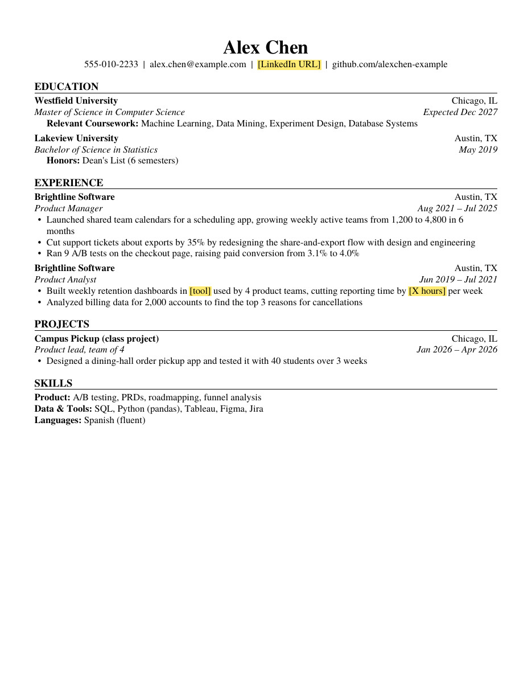
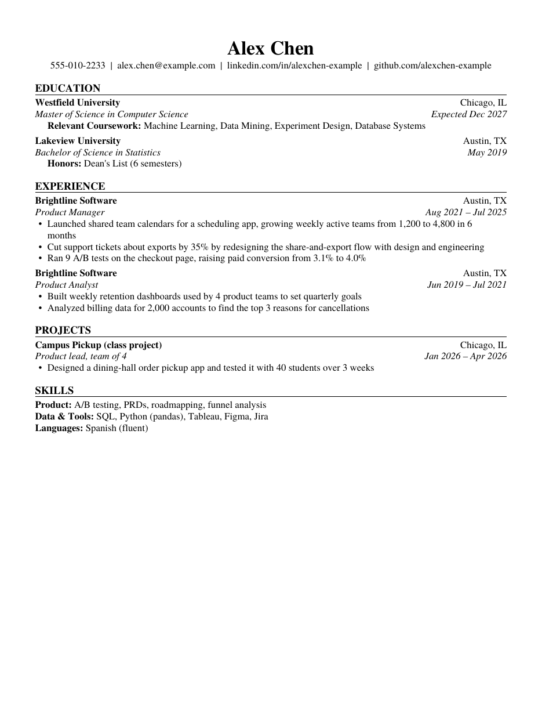

# Tech Resume Buddy

Tailors your tech resume to a specific job posting, using only your own experience. A Claude skill.

Paste a job posting, and it checks whether you meet the requirements, then suggests edits to your resume for that role. Each edit shows what changed and where the facts came from. For the next job, paste the next posting and get another version.

It also formats the resume in a standard one-page US layout, converts Chinese resumes to US style, and helps with interview prep.

It works for product management, software engineering, data, machine learning, UX and technical program management roles, and for students as well as people with full-time experience.

## How it works

**1. Share your resume. Get a preview right away.**
Upload your resume (PDF, Word, or pasted text, in English or Chinese). The first reply is a PDF preview in a clean one-page layout, with the bullets already rewritten. Anything it doesn't know yet, such as a number, a tool or a date, is left as a highlighted placeholder instead of being made up.

| Preview with placeholders | Final version |
|---|---|
|  |  |

<sub>Example resume is fictional.</sub>

**2. Fill in the gaps and add a job posting.**
It asks short questions to fill in the placeholders. Then it asks for the posting of a specific job you want to apply to, because tailoring only works against a real target.

**3. Tailor to the job.**
- Checks hard requirements first: degree level, graduation date, availability, location, work authorization (including CPT for F-1 students).
- Labels each qualification as strong, partial or missing, and computes a fit score with a fixed formula, so the same labels always give the same score.
- Proposes specific edits. Each one shows before and after, the writing rule it follows, and where the facts came from. You accept, change or reject each one.

**4. Download.**
A one-page PDF and a Word file. The final export won't run while any placeholder is left.

**5. Prepare for the interview.**
Likely follow-up questions for each bullet, and a story bank that maps your experiences to common behavioral questions (conflict, failure, ambiguity, and so on).

It can also:
- review a resume without a job posting, bullet by bullet
- convert a Chinese resume to US style (what to remove, how to present GPA, awards and team projects)
- build a "case library" of your experiences through a short interview, so you have more material than fits on one page

## Principles

- **Only your facts.** It never adds a tool, a result or a number you didn't give it. If a bullet needs a number, it asks.
- **You approve every change.**
- **Rules come from sources.** Writing and format rules are distilled from university career center guides (CMU, MIT, Yale, Duke, UMD and others). The TPM guidance is distilled from real internship postings. Every rule in `references/role-playbooks.md` cites its source.

## Install

**Claude apps (web, desktop):** download this repository as a ZIP (green **Code** button → **Download ZIP**), then upload it in Claude's settings under Skills. Start a new chat and share your resume.

**Claude Code:** copy this folder to `~/.claude/skills/tech-resume-buddy/`.

The scripts need Python 3 with `reportlab` and `python-docx`, which are available in Claude's environment.

## What's inside

```
SKILL.md                       how the skill works, step by step
references/role-playbooks.md   bullet checklist, layout, role guides, Chinese-to-US conversion, interview prep, sources
references/writing-guide.md    rules for tailoring to a job (G1-G8)
references/jd-check.md         how a job posting is checked
scripts/fit_score.py           fit score and verdict
scripts/render_resume.py       one-page PDF and Word export, preview with placeholders
templates/                     example resume data, case library template
```

## Limits

- Fit scores depend on how the model labels each requirement, so they can vary a little between runs.
- Company-specific rules (application limits, interview formats) are not included.
- It gives writing advice, not career or immigration advice. Confirm work authorization questions with your school and the employer.

## License

MIT
